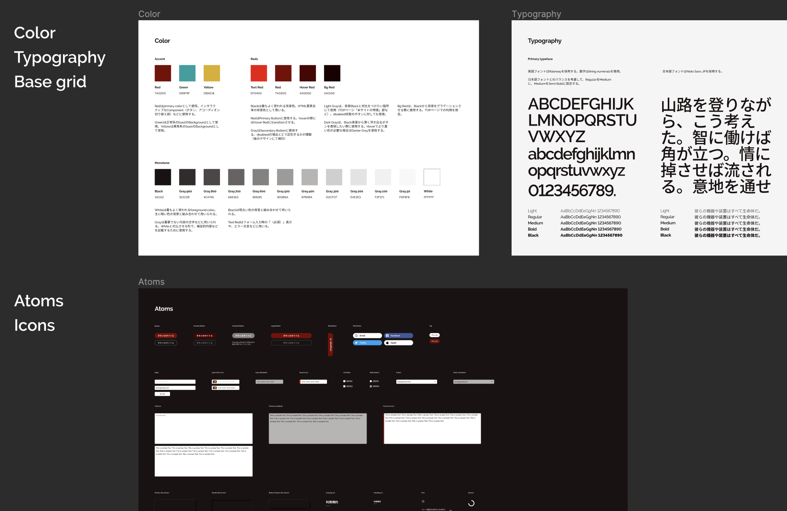
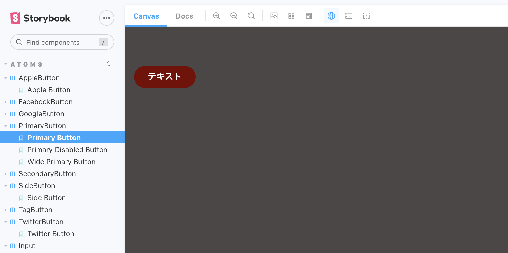

## Late December Through the New Year Holidays

Like the first half of the month, late December was pretty hectic at my day job. On top of that, there were various meetings and wrap-up parties for my side work and my choir activities, so I didn't have much time to spare.

Since late December alone doesn't give me much to write about, this post covers everything through the New Year holidays.

This is a bit off topic, but this year I want to make time not just for building things but also for learning. As a first step, I've [started working through _30日でできる！OS自作入門_ (a Japanese book on building your own OS in 30 days)](https://zenn.dev/chorkaichan/scraps/28567f1358495b) since the start of the year. As long as I have the time, I'd like to keep studying even after I finish this book.

## Development Updates

### Building Components

Last month I talked about moving off Firebase, but the changes to the data structure also mean the screen designs need some work. So I decided to take the opportunity to rework the frontend as well.

Actually, I started building a design system around last fall, so I'm all set to reorganize the components.

↑ This is made in Figma and is publicly available [here](https://www.figma.com/file/2v5qqGLNAAqpKn5TX0H2VW/initium-%3B-auditorium?node-id=0%3A1). Take a look if you're interested.

Back in 2020, when I put initium ; auditorium together in a hurry, I built it using [Atomic Design](https://www.codegrid.net/articles/2017-atomic-design-1/), but I sorted things into Atoms/Molecules/Organisms rather haphazardly, and as a result the component structure has become quite complicated.

(From this I learned that trying to follow Atomic Design without a design system in place just ends up half-baked. In fact, in the smartphone app I didn't use Atomic Design and only split things into rough Components.)

You can probably get a rough idea from the image above, but a design system is something where you set principles for things like color and text, then design each component in a structured way, and keep updating it as the product grows. (There's no strict definition of a design system, but that's how I'll treat it here.)

If a web designer joins in the future and starts giving feedback on the design, I think having something like this is important so we can have clear discussions. Above all, this is already the second major refactoring since the first release, so I want to get the quality to a level where we won't need another major refactoring for the next three years.

I've also decided to move from tailwindcss to Chakra UI and to build components with storybook.

tailwindcss's fast rendering is attractive, but because you specify classes as strings, it's hard to benefit from type checking. Chakra UI is slower since it's CSS-in-JS, but it only drops the FCP (First Contentful Paint) by about 10 points, so I decided that's acceptable.

So now the old code uses tailwindcss and the new code uses Chakra UI, and on top of that Firebase and MongoDB are mixed together too, so even starting up Next.js to check things is quite a chore. That's part of why I introduced storybook.

I had actually introduced storybook back in 2020, but it became an empty formality along with Atomic Design. It might end up the same way again once the move to Chakra UI is done, but for now I'm prioritizing building the components.

storybook lets you display each component on its own web page, so you can check how each element actually looks and behaves.

Even a single button has all sorts of states: hover, active (selected), disabled (can't be pressed), and so on. There are behaviors specific to the web, like keeping the default mouse cursor when hovering over a disabled button, or darkening the button background a little when it's active to show it can be selected.

When you're building features and components at the same time, you can sometimes get careless about managing component states. But storybook lets you separate feature development from component development (at least mentally), so I feel that happens less often...

## Plans for January

I'll keep working on components for a while. The current design system doesn't cover the TOP page or the admin screens yet, so I might start on those.

I'm still undecided on the TOP page design. I might just keep it as is for now, but I've been vaguely thinking it'd be nice to add a diagram explaining how purchasing works, which has gotten confusing since the lecture videos were released, or to put the content front and center like in the smartphone app.

My day job is going to be busy in January too, but I'll keep at it while taking care of my health.
