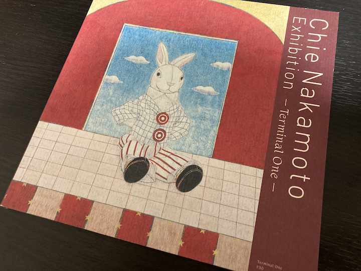

## Introduction

It's been almost a year and a half since initium ; auditorium was released.

At the time of the release, I had just changed jobs and was strongly motivated to pick up skills as fast as I could. Around the same time, Japan's first state of emergency was declared, and musicians who had lost their chances to perform were searching for places to play.

Out of that trial and error came [initium ; auditorium](https://www.initium-auditorium.com), a video streaming service.

Back then, I had no idea what I was doing. I was just desperate to find something I could do for performers who were watching their job offers disappear one after another. But a year and a half has passed since then. There are still limits on audience seating and on contact with other people, but concerts can mostly be held again, and with the help of subsidies, the financial worries have eased a lot compared to back then.

So what keeps me so eager to keep developing it now? That's what I'd like to write about this time.

\*The following are my personal views and do not represent any organization I belong to.

## I Like to Think

I like to think. When I was in elementary school I went through something like mild bullying, and even then I found myself wondering, "Why do people bully others?"

When I started singing in a choir in junior high, I often bought CDs, sheet music, and even poetry collections, and mulled over every note and every word. I also had the experience of a piece I didn't really get on first listen gradually sinking in and making sense as we rehearsed it again and again. (Come to think of it, that may have been the formative experience behind initium ; auditorium's theme, "ここから、「わからない」を旅しよう。" (roughly, "From here, let's journey through the things we don't understand.").)

When I came to Tokyo for university, I started going to art museums a lot. I'd tour the museums in Roppongi, or read books at the Junkudo bookstore in the Tokyu department store in Shibuya and then stop by the art gallery on an upper floor. That was around when I started getting interested not just in music but in the arts in general.

↑ A catalog of works given out for free at the art gallery

An exhibition can sometimes hit you hard enough to completely change how you see the world. Looking at something you've always seen from the other side makes you notice things you never would have thought of. Running into something beyond the bounds of your own common sense makes you realize something completely new. Something you could only grasp abstractly in the moment can, after chewing on it for a long time, lead to discoveries that even change your values. For someone who already loves to think, art was something I couldn't do without.

## Slowly Declining, and Eventually Gone

My view is that the more diverse art is, the better, because the more diverse it is, the more it's full of new discoveries.

Traditional cultures that have lasted for decades or centuries. New cultures that are being born right now. Cultures at their peak, recognized by many and about to grow even further. I think every one of them is irreplaceable.

However, cultures that stop getting attention slowly but steadily decline, and eventually disappear without anyone noticing.

The other day I came across [an article saying there is now only one craftsman left who makes Chikuzen biwa](https://www.fiat-auto.co.jp/ciao/doriano_sulis/). Many people probably think of _The Tale of the Heike_ when they hear "biwa hōshi" (the blind lute-playing monks who recited it), but one type of biwa is now in danger of dying out. I'll admit that I myself didn't know there were several kinds of biwa, that one of them was in this situation, or even what it sounds like.

\*Here's [a link to a biwa performance](https://www.youtube.com/watch?v=TJ2NpHZ_kDk) from the Traditional Music Digital Library at Senzoku Gakuen.

Having no instrument makers means there's little demand for the instrument. Little demand means there are few players. Few players means few people ever hear it played (especially live). Few people hearing it played speeds up the decline in players even more. As this negative feedback loop progresses, slowly but surely, the culture slowly declines and eventually disappears.

## Cultures That Don't Fit Well with a Social-Media-Driven Society

Unfortunately, I think there are cultures that just don't fit well with a social-media-driven society. I said "social-media-driven society," but you could also call it an "advertising-driven society." Fans posting their impressions on social media is itself a form of advertising these days.

The more attention something gets, the more effective the advertising becomes. Put the other way around, creators who can produce content that gets attention become that much more valuable (as advertising). And when they actually take on advertising work, they become even more widely known. As a result, their value (as advertising) goes up even more... and you get a positive feedback loop.

A typical example of a culture that fits well with this advertising-driven society is popular music, such as J-POP. This mainstream music, called by various names over the years (ryūkōka, kayōkyoku, J-POP), has spread widely over the last 100 years through radio, TV, and the internet. It's so commonplace that anyone who has lived in Japanese culture for a long time can probably recite a phrase or two from memory.

As the name suggests, popular music has long been loved by many people through the media. When a song that was popular in your school days plays around town, you can't help feeling nostalgic and listening in. Naturally, creators of popular music are prized for that catchiness.

YouTube is a prime example of skillfully turning this situation into a system. Instead of just letting you watch videos, it shows ads. Viewers want to see what comes next, so they put up with a few to a dozen-plus seconds of ads, thinking, "It's annoying, but it's free, so whatever." As a result, the content of the ads sinks in without them noticing, and thanks to the [mere-exposure effect](https://ja.wikipedia.org/wiki/%E5%8D%98%E7%B4%94%E6%8E%A5%E8%A7%A6%E5%8A%B9%E6%9E%9C), sales of the advertised products may go up.

Advertisers want to reach more people, and people who are more interested. Creators, by going viral, can deliver ads to more people and earn money from it. YouTube (the platform) matches ads with viewers, shows more relevant ads, and boosts their effectiveness to maximize ad revenue.

In the sense that it naturally builds this kind of win-win-win structure, you could say YouTube has a very clever strategy.

So what kind of culture doesn't fit well with an advertising-driven society? Flip everything above around and you get content for small audiences and high-margin, low-volume businesses (the opposite of low-margin, high-volume). Classical music, for example, falls into this category.

It was always a business where the best you could hope for was selling tickets at a few thousand yen a seat in halls holding a few thousand people at most. Popular music, on the other hand, is a business where million sellers (over a million copies sold) are nothing unusual. The number of consumers is literally orders of magnitude different.

Of course, the situation varies within classical music too. The piano, for example, likely has a large market, partly thanks to the [piano boom](https://www.excite.co.jp/news/article/Bizjournal_mixi201901_post-14358/) during Japan's period of rapid economic growth. In genres with relatively large markets like this, top professionals and well-known influencers can probably manage to make a comfortable living.

Now, what about the biwa I mentioned earlier? Do you know the names of any top biwa professionals? How much do you know about the people who make a living from the biwa? I'm embarrassed to say that I don't know much either. The first thing you learn about the biwa is its plight, not its sound.

An advertising-driven society gives everyone an equal chance based on a concrete metric: view counts. But just as the descendants of the wealthy are born with financial opportunities, those chances aren't fair.

## Growing a Culture Takes Time

Some might argue, "Then why not just put effort into growing the culture now?"

Take HIKAKIN, for example. He's a key figure who helped grow two cultures: YouTubers and beatboxing. He gained recognition after appearing on Hamonepu (a TV a cappella contest), but at the time neither YouTube nor beatboxing was as big as it is now, so his influence was probably limited. Still, through tireless effort and his ability to get the word out, he established his position over ten years. Now there are many YouTubers and beatboxers active out there. It's a success story of a culture taking off.

But even so, it took ten years. In fact, most big companies, including the GAFA companies, also grew over ten years or more.

My apologies to everyone involved for bringing it up so many times, but let me use the biwa as an example again.

First, in this advertising-driven society, getting attention is what matters. Let's say a biwa player finds some way to share the biwa's potential in an appealing way and wins over lots of fans. How much time would that take? How much effort would it take to create the content?

Let's say we try to increase the number of biwa players. How many people would be interested? With so few makers, how many people could buy an instrument that's anything but cheap?

Let's say someone works hard at activities that help the culture grow. On top of the time and effort spent earning a living, there's the burden of all that extra activity. How many people could put up with that life?

Even thinking about it briefly, it's easy to imagine how hard it is. (That's exactly why I have deep respect for the people who are on the front lines helping cultures grow right now.)

## My Motivation and Where I'm Headed

I like to think. And I love the diverse cultures that encourage it. But the fact that some cultures are about to disappear right now leaves me a little uneasy. My motivation is to witness these cultures survive, grow, and collaborate, and new cultures bloom out of that whole process, and to satisfy my own intellectual curiosity along the way.

But there are two challenges. There are cultures that don't fit well with a social-media-driven (advertising-driven) society, and growing those cultures takes a long time.

The latter is something only the people directly involved can solve. If an outsider who doesn't fully understand the culture's appeal pokes their nose in, it'll just end up as a stopgap.

The former, on the other hand, is simply a structural problem. I think problems like this often go better with help from a third party than when the people inside the structure try to solve them on their own. If you think of the relationship between a company and a consultant, it probably makes sense.

As for business schemes that don't rely on advertising, Netflix is probably the leading success story. initium ; auditorium takes a fairly similar strategy in that respect. The difference is that at Netflix, creators and viewers are separate, whereas in the fields around classical music, performers and audiences overlap. In other words, there's a large group of people who are both creators and viewers.

Flip that around, and if you offer a service that's attractive to creators, the creators and viewers around them will gather too. I think chaining this positive feedback loop is the path to growing into a service that lots of users actually use.

initium ; auditorium is still very much a work in progress. Far from helping a culture grow, it's not very well known yet, and there's plenty of room to improve the service's functionality itself. Knowing it'll take time, I need to keep improving it little by little.

At the same time, there's a time limit. If I want to keep having cultural experiences when I'm 60, and I assume it takes 20 years for one generation to hand off to the next, I need to have things ready to welcome the next generation by the time I'm 40 at the latest. My feeling is that how much I can build up over the next ten-odd years will decide how rich my life is in old age.

## In Closing

I'm currently involved in several projects, including initium ; auditorium. Each takes a different approach, but they all share the goal of protecting cultures and helping new ones grow.

One person alone can't do much, but with many people who share the same view, we can really get the word out. I'd be grateful if you'd keep a warm eye on what we're doing.
