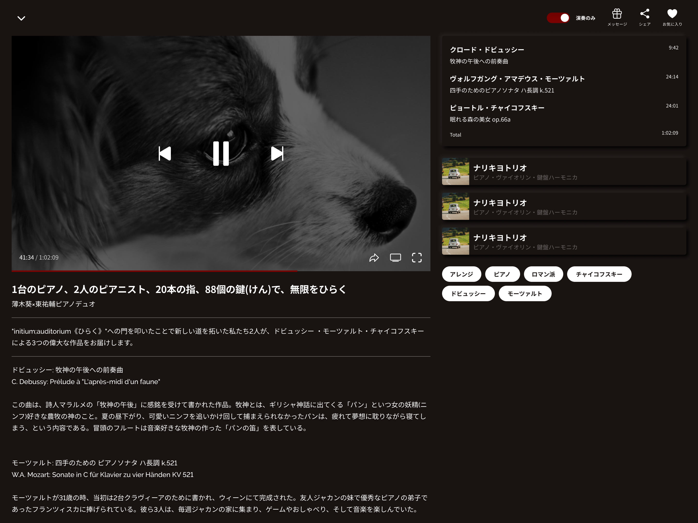
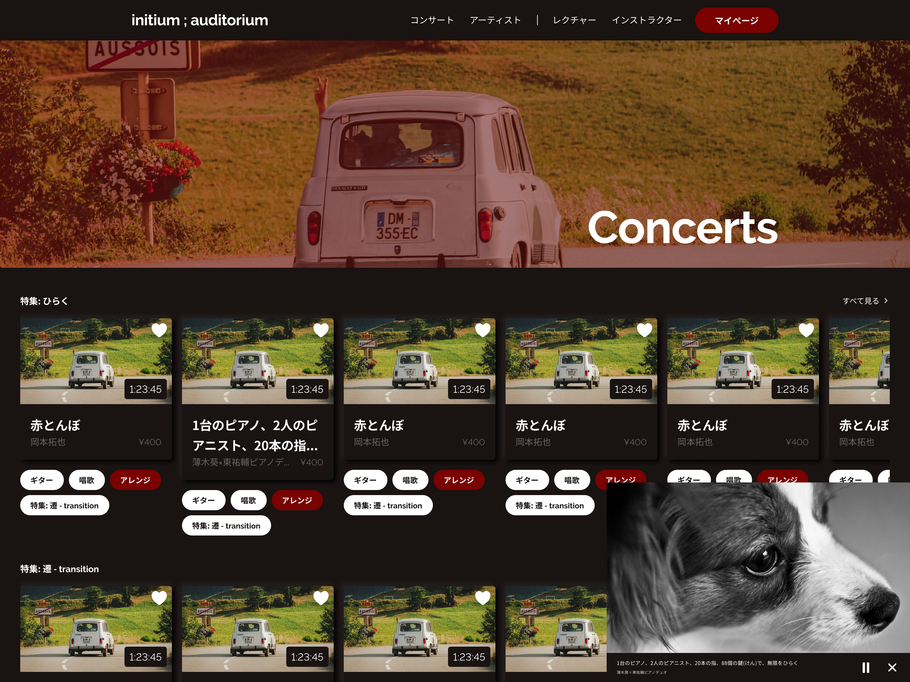

## Late February to Late March

March was all about choir for the first time in a while.

Between a joint concert featuring in high glee, the choir I belong to, and taking part in the JCA Youth Choir, I couldn't spend much time on development. I'm actually writing this post on the plane home from the JCA Youth Choir.

Since this blog is mainly about tech, I'll skip the details, but both were wonderful experiences. I'd like to carry this refreshed feeling into what comes next.

## Development Status

### Connecting the Various APIs

I've finished connecting to the APIs of the various services the renewed website will use. MongoDB and Stripe went relatively smoothly, but AWS Cognito had one pitfall, so I'll note it here for future reference.

When an AWS Cognito user changes their email address and you use Cognito's built-in API as is, a verification code gets sent to the new email address, but the email address inside Cognito is overwritten before the code has even been verified. (I'm writing this on a plane, so please forgive me for not including reference URLs.)

So I built my own mechanism for checking the verification code, and changed things so the email address is only updated after verification.

Also, I'm currently distributing revenue to artists by hand after payments, and in parallel I'm working on a system to automate that.

It'll be summer 2022 at the earliest before it's actually implemented, but I'd like everything to be automated by the start of the 2023 fiscal year.

### Website Design

Along with the review of the data structures, I've also made major changes to the website design.

The biggest change is the video viewing page. I widened the content area so that the video, track list, artist information, notes, and so on can all be seen at a glance.

I also made it so the video keeps playing even when you navigate to other pages. You can now look for other videos or read an artist's profile while watching. You wouldn't need this with AirPlay, but I think it's a better user experience if the video just keeps playing without you having to press a button.

As before, I've cut out unnecessary information other than the videos and notes (view counts, like counts, number of purchasers, etc.), aiming for a screen that lets you immerse yourself in the work.

Whether you're one of the performing artists or a user, please feel free to send any requests you have.

## Plans for April

My choir activities settle down after March, so I expect to have relatively more time for development in April.

Most of the website work is done, so next up is mainly reworking the app side. I'd like to release the renewed version within April if possible, but whether I'll make it in time... I'll do my best.

I'm also looking for people who can help with feature development and testing. To keep communication costs down and prevent information leaks, I'm limiting it to just 1-2 people, with priority given to people I know. A limited period of a few months is fine too.

(As an organization we're barely making any profit, so I can't promise any pay. I really feel bad about it, but please take that into account when considering.)

If you want to get hands-on with or learn technologies like React, Next.js, React Native, AWS, MongoDB, Stripe, and so on, I think it's a good opportunity to work on a system that's actually running in production. (If that's your motivation, I think you'll get something out of it even without pay, so it's a relatively healthy arrangement.)

It's even better if you share the wish to liven up fields like early music, contemporary music, improvisation, folk music, choral music, instrumental music, and so on. If you're willing to help, please get in touch with me, Kikuchi (my Twitter DMs are open. ID: @chorkaichan).
