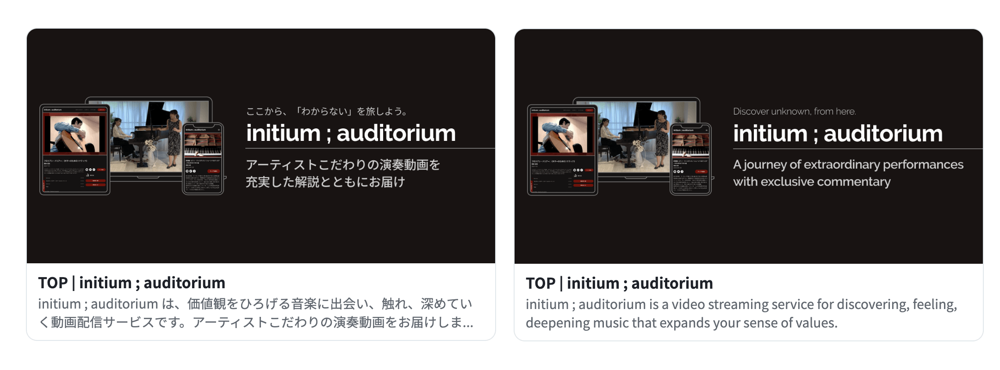

## April

In April I was able to focus on development relatively well. Thanks to that, most of the feature development is done, and what's left is planning the server migration and multilingual support.

Also, in [my previous post](https://chorkaichan.github.io/en/blog/202203-late) I put out a call for people who could help with feature development and testing, and one person raised their hand and is already working away at full speed.

They had programming experience but none with Node.js and the surrounding ecosystem, React included, so they seemed a bit worried, but once we got going, it turned out they were skilled enough to catch up in 1-2 weeks and start building features. I couldn't be more grateful.

## Development Status

### I Started Managing Tickets

As mentioned above, since development now involves multiple people, I started managing tickets with GitHub Issues.

Actually trying it out, I found that everything, from sharing what we're working on to reviews, can be done entirely on GitHub, which is really comfortable.

Being able to review PRs from the mobile app was a new experience, too. Reviewing from bed is nice.

### Fixing the App's Login Bug

When logging in to the auditorium mobile app, there was a bug where the [login process would fail](https://zenn.dev/chorkaichan/articles/09373b26ee2a4c) every now and then. I've addressed this, and after the renewal you'll be able to log in without problems.

In the current app, social login sends you to the auditorium website, which then calls Firebase Authentication, and that's where the error occurs. [Firebase seems to be aware of the problem](https://github.com/firebase/firebase-js-sdk/issues/4256#issuecomment-852252857), but there's still no fundamental fix.

After the renewal, I dealt with this by changing things so social login is called directly. This means the login process has to be implemented separately on the website and in the app, but once I actually did it, the amount of code was about the same as before. If anything, things got easier to follow, since the website's login implementation no longer has to account for the app's use cases.

### Multilingual Support

We've supported multiple languages for a while, but OGP (the mechanism that shows the card-style link when you share on Twitter and the like) wasn't fully covered, so everyone's shares showed up in English.

So I decided to issue separate URLs for Japanese and English and change the OGP content depending on the URL. This way, Japanese users get a Japanese preview and non-Japanese users get an English one.

Left: https://www.initium-auditorium.com 
Right: `https://www.initium-auditorium.com/en` (this link is currently broken since it hasn't been released yet)

As before, whether the site first shows up in Japanese or English is decided automatically based on the user's browser settings.

### Redirects from Old URLs

Until now, content and artist URLs looked like `https://www.initium-auditorium.com/artist/qwerty`, and I felt having an id at the end wasn't very cool.

So after the renewal, I changed it to use meaningful paths, like `https://www.initium-auditorium.com/artist/vocalconsort-initium`.

However, this means the old links would no longer work. Considering that some people have posted auditorium links on their own blogs, and others use Twitter bots to automatically promote auditorium links, the impact would be significant.

So I set things up so that visiting an old URL automatically takes you to the new one. All the links you've posted so far will keep working, and you can use the easier-to-understand URLs going forward.

## Plans for May

Sorry to have kept you waiting so long, but the auditorium renewal is expected to be completed within May.

I'll contact all of our users as soon as the migration plan is finalized, so please bear with us a little longer.
