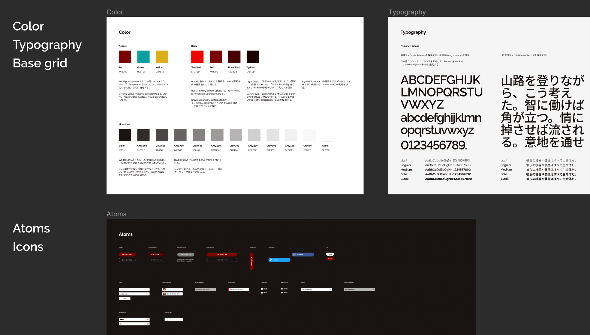
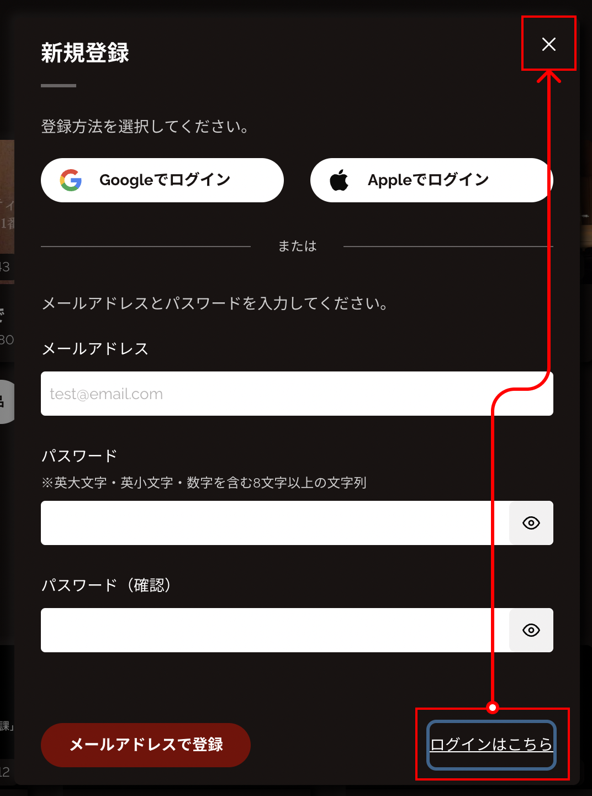

## Introduction

On 5/14-15, I migrated the system behind [initium ; auditorium](https://www.initium-auditorium.com). It may be a small project, but it was a valuable experience, so I'd like to write it down as a record.

Here's what the system looked like before and after the migration.

| Category             | Before                     | After                                |
| -------------------- | -------------------------- | ------------------------------------ |
| UI library           | -                          | Chakra UI                            |
| Authentication       | Firebase Auth              | Cognito                              |
| DB                   | Firebase Firestore         | MongoDB                              |
| Storage              | Cloud storage for Firebase | S3                                   |
| Video delivery       | Mux                        | Mux                                  |
| API (scheduled jobs) | Firebase Functions         | Lambda                               |
| Email delivery       | Mailgun                    | SES                                  |
| Hosting              | Vercel                     | Cloudfront + S3 (Serverless Next.js) |
| DNS                  | Muumuu Domain              | Route53                              |

As you can see, everything except video delivery has been replaced, mostly with services provided by AWS. First, I'll go through each of them.

## UI Library

I started developing initium ; auditorium in 2020, but between my lack of skill back then and all the features and spec changes added since, things were pretty messy before the migration. I'd tried to follow [Atomic Design](https://design.dena.com/design/atomic-design-%E3%82%92%E5%88%86%E3%81%8B%E3%81%A3%E3%81%9F%E3%81%A4%E3%82%82%E3%82%8A%E3%81%AB%E3%81%AA%E3%82%8B) and ended up with an even more complicated component structure, the code had become [WET](https://atmarkit.itmedia.co.jp/ait/articles/1706/01/news167_3.html)...

Since I was planning the system migration anyway and much of the source code would change, I took it as a good opportunity to rebuild the frontend from scratch as well.

#### Introducing a Design System

Until now, I'd been designing at the coarse level of one page at a time. I wasn't turning parts into components in Figma, just laying them out.

As a result, even at the development stage it was unclear which parts should become shared components, and the code ended up in a messy state that looked like Atomic Design but really wasn't.

So this time, I made a point of keeping Atomic Design in mind from the design stage. I used "[UI2](https://www.figma.com/community/file/928108847914589057)", a design system officially provided by Figma, as a base, and adjusted it to fit the Atomic Design way of thinking.



This made the split into Atoms/Molecules/Organisms components much cleaner.

#### Introducing Chakra UI

Besides how components were split, the existing code had various other problems. One of them was accessibility.

For example, imagine a modal like the one below, and a user who can't use a mouse moving the focus by pressing the Tab key. After the focus moves to the bottom right of the modal, pressing Tab again should naturally move the focus to the top right. But before the migration, I hadn't taken this kind of thing into account, so the focus would land on elements behind the modal.



That said, developing with accessibility like this in mind isn't easy. I could easily imagine missing something somewhere.

So this time, I dealt with this by adopting [Chakra UI](https://chakra-ui.com/). UI libraries like this take accessibility into account out of the box, which simplifies implementation.

There are other libraries like [MUI](https://mui.com/), but I remembered someone from JX Press Corporation saying "Chakra UI is great" ([blog post](https://tech.jxpress.net/entry/utility-first-css-in-js)), and honestly, I went with Chakra UI without thinking about it too much.

It's really easy to use, and since props have type constraints, it works well with TypeScript, so I'm finding it very handy. However, since I was writing everything in Tailwind CSS before the migration, [Headless UI](https://headlessui.dev/) might have been the easier choice (at the time, I didn't know there were UI libraries built on Tailwind). Still, the benefits of types are big, so I plan to keep using Chakra UI.

## Authentication

What got me thinking about a system migration in the first place were two problems with authentication.

- Social login with Firebase Auth was frequently interrupted (details [here](https://zenn.dev/chorkaichan/articles/09373b26ee2a4c))
- Emails arrived slowly, even though we were using email link authentication

An [issue was opened](https://github.com/firebase/firebase-js-sdk/issues/4256) about social login being frequently interrupted in early 2021, but there's still no fundamental fix, and people report reproducing it every few days. It probably stems from browsers getting stricter about how they handle cookies, but Firebase's internals are a black box, so the details aren't clear.

To deal with this, I decided to reimplement authentication with Cognito. At the same time, I dropped email link authentication, which had a reputation for being hard to use, and switched to signing in with an email address and password.

#### Things to Watch Out for When Implementing Cognito

Not just Cognito, but AWS services in general have their quirks when you implement them. Still, there are plenty of explanatory articles out there, mainly from [Classmethod](https://dev.classmethod.jp/tags/amazon-cognito/), so I was able to get through it without too much trouble.

The one pitfall was how it behaves when changing an email address. Simply put, "when changing an email address, Cognito's email address information gets overwritten before code verification is complete." [AWS is apparently aware of this bug](https://github.com/aws-amplify/amplify-js/issues/987#issuecomment-531025897), but it seems to have been put on the back burner...

That said, there are plenty of [articles about this problem](https://www.tolog.info/aws/cognito-address-change/) out there, and I was able to work around it by implementing my own version based on them. If you want to know the details, please give it a quick search.

## DB

Since I stopped using Firebase Auth, I could no longer integrate with Firestore, so I migrated the DB too (my reasons for choosing MongoDB are [here](https://chorkaichan.github.io/en/blog/202111-late)).

Features added since launch had left the DB schema a mess, but I was able to clean it up through this migration. I'll cover the migration itself later.

## Storage

For storage, all I did was move the data over and rewrite the file URLs in the database, so I'll skip it.

## Video Delivery

I'm still using [Mux](https://www.mux.com/) for video delivery. I'd like to move this to AWS eventually too, but it's fairly low on the priority list.

## API (Scheduled Jobs)

I ported the scheduled functions written as Firebase Functions to Lambda. I'm using [Serverless Offline](https://www.serverless.com/plugins/serverless-offline), which lets me run them locally and also automate deployment.

## Email Delivery

We've also received a lot of inquiries about emails arriving late.

Besides [Mailgun](https://www.mailgun.com/), I've also used [SendGrid](https://sendgrid.com/), and with both, it was common for emails to arrive a few minutes late. With services that have [strict email filtering](https://jpneet.com/gadget/hotmail_dontget/), like Hotmail, emails often didn't arrive at all or ended up in spam. My guess is that, since the IPs are shared, a few users abusing the service drag down the [reputation](https://baremail.jp/blog/2019/08/27/280/), which leads to problems like these.

So I looked into various email services, and AWS SES had dramatically better delivery rates and speed, even with a shared IP, so I decided to go with it this time. This is also a guess, but since [you have to apply before using SES in production](https://dev.classmethod.jp/articles/relaxing-send-limit-and-removing-sandbox-restriction-in-ses/), I think they've managed to keep malicious users out.

Whatever the truth is, from testing until now, there hasn't been a single delay in email delivery. SES is great.

## Hosting

If you're developing with Next.js, hosting on Vercel is the usual choice. However, the 20 USD per developer per month quietly adds up, and it was taking up a large share of our running costs.

\*The Hobby plan is free, but the number of APIs on the current site exceeds the Hobby plan's limits, so we have to choose the Pro plan.

So, to save even a little, I decided to adopt [Serverless Next.js](https://www.serverless.com/plugins/serverless-nextjs-plugin).

#### Serverless Next.js

There are a few articles about Serverless Next.js, but you don't see many saying they're running it in production.

So I was a bit nervous, but basic features like ISR are already implemented and there are no critical bugs, so I feel it's a library that can handle production use just fine.

I've noticed a few things so far, so I'll list them below for future reference.

#### Policy and Role Aren't Carried Over

This is the problem that causes the 503 errors described in [this article](https://zenn.dev/makumattun/articles/c091602d3060d3#isr%E3%82%92%E8%A8%AD%E5%AE%9A%E3%81%97%E3%81%9F%E3%83%9A%E3%83%BC%E3%82%B8%E3%81%A7503%E3%82%A8%E3%83%A9%E3%83%BC%E3%81%AE%E9%A0%BB%E7%99%BA). ISR in Serverless Next.js works by sending a message through SQS to a Lambda that runs ISR, but because the Policy and Role aren't carried over on deploy, you get a Permission error.

You can work around this by copying the Policy and Role created on the first deploy into separate ones, and specifying them in the serverless.yml file.

```
# serverless.yml
auditorium:
  component: "@sls-next/serverless-component@3.8.0-alpha.0"
    inputs:
      # Specify the Policy below
      policy: "arn:aws:iam::123456789012:policy/ServerlessFuctionPolicy"
      # The Role is fine as long as it includes the Policy below
      roleArn: "arn:aws:iam::123456789012:role/ServerlessFunctionDeploy"
      ...
```

```
{
  "Version": "2012-10-17",
  "Statement": [
    {
      "Sid": "VisualEditor0",
      "Effect": "Allow",
      "Action": [
        "lambda:CreateFunction",
        "iam:UpdateAssumeRolePolicy",
        "lambda:TagResource",
        "cloudfront:ListFieldLevelEncryptionConfigs",
        "s3:CreateBucket",
        "iam:CreateRole",
        "lambda:GetFunctionConfiguration",
        "iam:AttachRolePolicy",
        "iam:PutRolePolicy",
        "route53:ListHostedZonesByName",
        "cloudfront:CreateInvalidation",
        "lambda:EnableReplication",
        "cloudfront:GetDistribution",
        "logs:CreateLogStream",
        "acm:RequestCertificate",
        "route53:ListResourceRecordSets",
        "lambda:DeleteFunction",
        "cloudfront:GetDistributionConfig",
        "iam:GetRole",
        "cloudfront:TagResource",
        "route53:ChangeResourceRecordSets",
        "sqs:GetQueueAttributes",
        "logs:CreateLogGroup",
        "lambda:UpdateFunctionCode",
        "s3:PutObject",
        "s3:GetObject",
        "acm:DescribeCertificate",
        "cloudfront:ListTagsForResource",
        "cloudfront:ListInvalidations",
        "lambda:ListEventSourceMappings",
        "sqs:DeleteQueue",
        "lambda:PublishVersion",
        "cloudfront:ListDistributionsByWebACLId",
        "cloudfront:ListCloudFrontOriginAccessIdentities",
        "s3:GetBucketTagging",
        "s3:PutAccelerateConfiguration",
        "s3:ListBucket",
        "s3:GetAccelerateConfiguration",
        "lambda:CreateEventSourceMapping",
        "sqs:*",
        "lambda:UntagResource",
        "cloudfront:CreateCloudFrontOriginAccessIdentity",
        "iam:PassRole",
        "lambda:ListTags",
        "s3:PutBucketTagging",
        "ses:*",
        "iam:DeleteRolePolicy",
        "acm:ListCertificates",
        "cloudfront:UpdateDistribution",
        "sqs:SetQueueAttributes",
        "cloudfront:UntagResource",
        "sqs:ListQueues",
        "lambda:GetFunction",
        "lambda:UpdateFunctionConfiguration",
        "cloudfront:CreateDistribution",
        "logs:PutLogEvents",
        "cloudfront:ListPublicKeys",
        "iam:CreateServiceLinkedRole",
        "cloudfront:ListDistributions",
        "cloudfront:ListFieldLevelEncryptionProfiles",
        "s3:PutBucketPolicy",
        "sqs:CreateQueue",
        "cloudfront:ListStreamingDistributions"
      ],
      "Resource": "*"
    }
  ]
}
```

#### ISR Times Out

Possibly because establishing the MongoDB connection takes time, ISR would occasionally time out and show a blank page.

This also improved after adjusting the Memory allocation and Timeout settings in serverless.yml.

```
# serverless.yml
auditorium:
  component: "@sls-next/serverless-component@3.8.0-alpha.0"
  inputs:
    memory:
      defaultLambda: 1024
      apiLambda: 2048
    timeout:
      defaultLambda: 30
      apiLambda: 30
    ...
```

As a side note, Daniel Phang, who had been active as a Core Maintainer, has stepped away from the project, and Serverless Next.js is currently somewhat stalled.

So if you're interested in Serverless Next.js, please consider contributing. If you read [this Issue](https://github.com/serverless-nextjs/serverless-next.js/issues/970) and then contact [serverlessnextjs@gmail.com](mailto:serverlessnextjs@gmail.com), you'll be invited to a Slack group where contributors gather. Let's do it together.

## DNS

Before the migration, someone else was managing the DNS side, so whenever a CNAME needed to be set, I had to share the details and have them set it up. I could have just transferred the domain, but I wanted to avoid spending money if possible...

So this time I brought in Route53 and moved everything, name servers included, to AWS, and now the developers can handle all the domain settings themselves. Happy ending.

## How the Migration Went

So far I've looked at each part in detail. Below, I'll go through the migration in chronological order.

#### 5/3

- Drew up the migration plan

#### 5/6

- Published the last content before the migration

#### 5/7

- Migrated content and artist information in the DB
  - I'd prepared scripts in advance so that a single command would write the data from Firestore to MongoDB (same for the steps below)

#### 5/8

- Posted on Twitter that the service would be unavailable from the night of 5/14
- Posted the same notice on the website
- Stopped selling concert passes (because the unlimited concert viewing period would overlap with the service downtime)

#### 5/10

- Submitted the iOS and Android apps for review
  - I submitted early, expecting to be rejected more than once

#### 5/11-5/13

- Fixed small bugs and so on

#### Night of 5/14

- Stopped the service
- Migrated the domain
- Migrated user information and sales information in the DB

#### 5/15

- Configured the domain for the production environment
- Final checks
- Opened the website
- Started distributing the mobile apps
- Emailed all users
- Dealt with a [mobile app bug](https://twitter.com/initium_a/status/1525748291895324672?s=20&t=7mRxO9e76CaVMQ1lFd9ZXg) discovered after release
- Resubmitted the iOS and Android apps for review

#### 5/16

- Rejected in app review, so submitted again
- Passed review. Started distributing the app with the bug fixed

## Wrapping Up

In this post I picked out the key points, but the hardest part was all the tedious work that wasn't even worth writing about. Even I'm impressed I saw it through over more than six months. Thanks to that, the code is a lot cleaner now.

From the second half of last year until now, I've been going all-out on the migration, but from here on I plan to take it easy on development and start thinking about where to take initium ; auditorium next. I'd like to talk to lots of people and figure out how to make it a better service.
