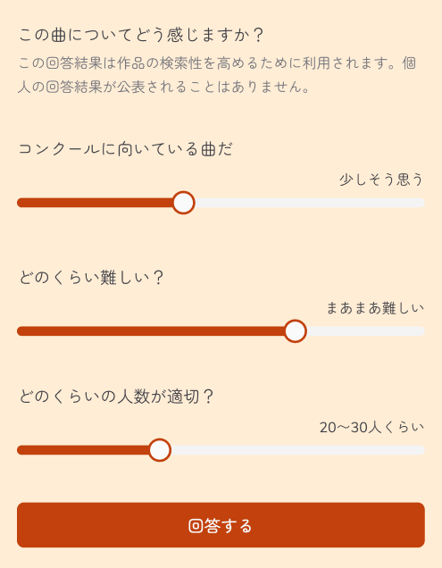

The other day I launched [ChoralLib](https://ChoralLib.com), a database of choral works. So far my post about it on X has received around 500 likes, and more than 100 entries have already been submitted to the database. I'm honestly surprised by how big the response has been.

At the same time, I've received many comments along the lines of "it would be great if it had this feature," so I felt I needed to share my plans for the future early on.

In this post, I'll talk as much as I can about how this service came to be, what it's for, and where it's headed. It's a brand-new service, so please keep in mind that it may change direction considerably depending on how things go.

## How This Service Came to Be

I've been singing in choirs for nearly 20 years, and almost every time I plan a new program, I run into the same problem: repertoire.

The pieces that come to mind are always the ones other groups have performed recently. I'll binge YouTube and Spotify trying to find something else, but it's hard to come across new pieces. Works by Japanese composers in particular are quite difficult to search for.

For major works from overseas, there are digital sheet music services like [nkoda](https://www.nkoda.com), and scores whose copyright has expired can be viewed on sites like [imslp](https://imslp.org). Even so, there are limits to how comprehensively you can search.

When I thought about a service that could fundamentally fix these problems, a choral music database came to mind quite naturally.

From the very beginning, I also decided that it would not depend on any particular organization, and that anyone would be able to contribute. This comes from lessons learned in past projects.

I've been involved in developing and running a number of music-related projects, but many of them stumbled not during development, but at the stage of maintaining and running them. You can push a project forward in a short, intensive 1–2 months, but running a project over a long period is far harder. For a for-profit organization it costs money; for a non-profit it costs time. And the longer it goes on, the more motivation gradually drops. As a result, many projects just kept shrinking. Opening a project up to anyone naturally comes with its own risks, but I think the operational benefits outweigh them.

And that's how ChoralLib, a choral music database built by everyone, came to be.

## What This Service Is For

As I mentioned above, the thing I care about most is "diversifying repertoire." If a wider range of pieces were performed at concerts, competitions, choral festivals and so on, I'm almost certain the community would become even more vibrant than it is now.

Also, while taking part in the World Youth Choir last year, I made a friend from Taiwan. His choir in Taiwan had chosen Naoto Aizawa's _Nantonaku Aozora_ for their entry in the Takarazuka International Chamber Chorus Contest. According to him, "a lot of choirs in Taiwanese competitions sing similar pieces...", so they were looking further afield, including at Japanese works. There are other examples too, such as the Indonesian Batavia Madrigal Singers commissioning Toyotaka Tsuchida's _Harukaze -Der Frühlingswind_, and performing Akira Miyoshi's _Chikyū e no Picnic_ on their Japan tour. Japanese choral works have been spreading remarkably among choirs overseas.

Turning to Japan, there's no doubt that choirs here have long performed a very wide range of works from abroad, and still do. But isn't it also true that this range stays within certain bounds? One example of music that is widely sung overseas but rarely performed in Japan is choral music from the Spanish-speaking world.

Stepping outside this thin filter bubble and offering a wider repertoire both in Japan and abroad is another of this service's goals. That's why every entry is required to include an internationally readable version (such as one in Latin script) alongside the original.

Beyond that, I'm trying to make this something that benefits everyone involved. It has to be useful, and never harmful, not only for musicians but also for publishers, composers and lyricists. So I want it to be a service that genuinely helps promote sales, while staying within the bounds of copyright.

## Future Plans

I'll list everything first and then go into the details.

### Phase 1 (Expanding the database features and stabilizing the system)

- Preventing duplicate submissions
- Adding different versions of a piece
- Improving search
- Favorites lists
- Adding recording information
- A reporting feature
- A rollback feature
- Internationalization

### Phase 2 (Expanding community features)

- Surveys to collect characteristics of pieces
- Better search based on those characteristics
- Performance history pages
- Going open source

### Phase 3 (Building a monetization scheme for financial stability)

- Strengthening the review process for information
- An API for music data

#### Preventing duplicate submissions

The most urgent issue is that pieces, composers and lyricists are being registered twice in many cases. At first I removed the duplicate check so that entries with the same name could exist, but far more duplicates were submitted than I expected, so I decided this needs to be handled by the system. I plan to fix it soon.

#### Adding different versions of a piece

I plan to add a feature for registering different versions of a piece, such as an equal-voice version derived from an original mixed-voice version.

#### Improving search

I plan to add a way to search for pieces by conditions such as voicing, duration and language.

#### Favorites lists

I plan to add a feature for making lists of your favorite pieces. For example, being able to create a list like "Candidate pieces for our 2025 concert" should come in handy when choosing repertoire. These lists will also be shareable publicly, so I'm imagining use cases like sharing the page to announce a concert program.

#### Adding recording information

I plan to let you add information about recordings uploaded to streaming services such as Spotify and Apple Music. YouTube, however, handles copyright after the fact (even when copyright is infringed, action is only taken once it's reported), so I have no plans to support it for now.

#### A reporting feature

To protect the data, entries can't be deleted in principle. So for things like duplicate submissions, I plan to set up a system where you report them with this feature and the operators handle the deletion. I expect this reporting feature to be used for inappropriate submissions in general as well.

#### A rollback feature

So that we can quickly restore the previous version when an improper submission is made, I plan to add a feature that keeps a history of past changes and lets us go back to an earlier state (a rollback feature).

#### Internationalization

I plan to support an English interface. With the release of this feature, I'll start offering the service to people outside Japan.

#### Surveys to collect characteristics of pieces

I plan to add surveys that collect characteristics of a piece based on subjective measures, such as how difficult it is or how well suited it is to competitions.

#### Better search based on those characteristics

I plan to add a way to search with conditions such as difficulty, based on the characteristics collected through the surveys. The goal is to make searches like "a fairly challenging, bright-sounding piece suited to competitions" possible.

#### Performance history pages

I plan to add a feature for creating a page that records the pieces you've performed so far. This lets each person build their own "choral timeline." Performance histories will also be shareable publicly, and I hope they'll give people something to talk about, like showing each other their timelines.

#### Going open source

Once the service has gained a certain share, I'm considering making it open source. I hope this will lead to more active and transparent operation. I also hope that similar efforts in other genres will help culture grow across fields.

#### Strengthening the review process for information

The aim is to strengthen the review process for submitted information and make the data more reliable.

#### An API for music data

By offering the data organized through reviews via an API, the aim is to quickly provide highly reliable data to the people and businesses who need it. The API will be offered as a paid service with appropriate fees, which will help put the finances on a sound footing.

## Closing

I've received many messages of support from all sorts of people on X, and they've been a huge encouragement. I'd like to take this opportunity to say thank you. As you can see above, there's still a long way to go, but with everyone's help I want to keep improving the features little by little and make this a better service.

This service aims to be useful for everyone involved in choral music. I always welcome opinions, such as "I'd love it if it had this feature too" or "I think this feature above might have this problem," so please reach out on X or when we meet in person. I'd be really happy to hear from you.
