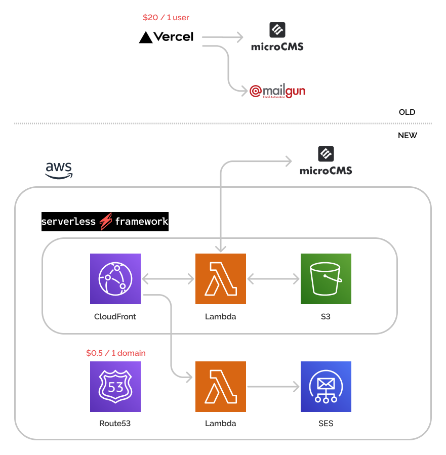

## Hello

Last year I launched the production team [musicolare](https://musicolare.com) and the video streaming service [initium ; auditorium](https://www.initium-auditorium.com), and I've been involved in both ever since, mainly on the development side.

I've shared things from an engineer's point of view here and there, but I never had a proper place to put it all together. Both for myself and for the brands, I figured it would be good to have a real place to write, so I've decided to start a tech blog.

Most posts will probably be development updates on musicolare and initium ; auditorium, but if you're a musician and have comments like "I'm struggling with this kind of problem," I'd like to pick them up in future posts. If something's bothering you, I'd be glad to hear from you in the comments.

## Development Updates for Early November

### Working on the Next initium ; auditorium Update

An update to initium ; auditorium is coming soon, and that's what I've been working on. It hasn't been announced yet, so I'll hold off on the details, but once it's out I plan to write about it here.

### Moving musicolare's Sites to AWS

At musicolare, we've been building sites with Next.js, hosting them on [Vercel](https://vercel.com), and using [MicroCMS](https://microcms.io) as our CMS. Vercel's Pro plan costs 20 USD per developer per month.

For musicolare alone, the free Hobby plan is plenty, but for team projects like initium ; auditorium the costs add up. Right now I'm the only one with a Pro account and I handle every deploy to Vercel myself, which is one of the reasons things have come to depend on me alone.

So I decided to start by moving the sites built by musicolare (for example, the [Shirube Choir website](https://shirube-choir.com)) over to AWS.

To host Next.js sites on AWS, I went with [serverless-nextjs](https://github.com/serverless-nextjs/serverless-next.js). In May this year there was [an article saying it now supports ISR](https://zenn.dev/makumattun/articles/6e260f3a5af117). When I tried it out earlier, the IAM settings had a few issues, but once configured properly, everything including ISR worked fine, so I've been using it ever since.

These sites don't get much traffic, so the only cost is about 0.5 USD/month for Route53. The mail server from [Muumuu Domain](https://muumuu-domain.com) costs 630 yen a year, so if you want email addresses on your own domain, it comes out to about the same price.

Also, AWS SES, which I set up as part of the move, has been really good for sending email. With SendGrid or Mailgun, delivery was sometimes delayed or emails occasionally didn't arrive at all, but with AWS SES I haven't had any of that stress.

## What's Next

For a while, I'll mainly be working on initium ; auditorium. Specifically, I'm working through the following, one by one:

- Moving to AWS
- Improving the UI/UX
- Improving the database schema

I've built initium ; auditorium in what little spare time I have, but features kept getting added on top of the original spec, and I started the project back when I wasn't very experienced in development, so the internals have gotten pretty complicated.

I plan to use the long break at the end of the year to improve it as much as I can.
